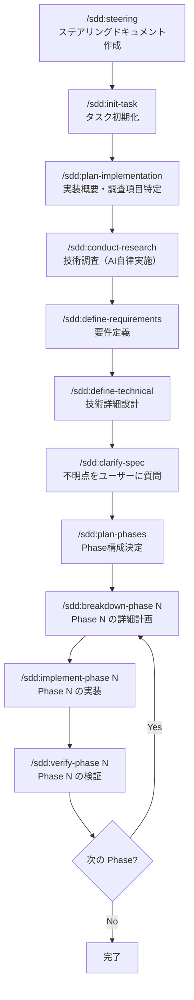

本記事は airCloset Advent Calendar 2025 の 13 日目の記事である。

https://qiita.com/advent-calendar/2025/air-closet

このアドベントカレンダーにはエンジニアをはじめ、弊社社員がさまざまな記事を投稿するので、よければ他の記事もご覧いただきたい。

## はじめに

Claude Code を使う人はもう多いので、Claude Code 自体の詳しい説明は省く。

弊社では 2025 年 6 月から、全エンジニアに Claude Code のチームプランのプレミアムシートか Max 5x / 20x が支給されている。筆者は 20x プランを毎日使い倒している。

Claude Code を使う中で、定型の作業や毎回の指示は slash command や hooks に、たまに使う手順は skills にして、ローカル環境に置いていた。複数の PC を切り替えても同じ環境を作れるように、これをプラグインにして GitHub で公開している。

この記事では、そのプラグインの機能を紹介する。次のリポジトリを marketplace に追加すれば、すぐに使える。ただし自分用なので、予告なく全体が変わる。使うことは勧めないが、参考にはしてほしい。

https://github.com/masseater/claude-code-plugin

このリポジトリは debug、sdd、mutils の 3 つのプラグインを提供している。順に紹介する。

## debug

プラグイン開発でデバッグするために作った。有効にすると、各イベントでログを出すだけの hook が動く。中身は単純なので説明は省く。詳細はコードを見てほしい。

https://github.com/masseater/claude-code-plugin/tree/main/plugins/debug

## sdd

いわゆる SDD（Spec Driven Development）のワークフローを提供するプラグインである。

仕様駆動の開発を支えるツールキットとしては、[cc-sdd](https://github.com/gotalab/cc-sdd)、[spec-workflow-mcp](https://github.com/Pimzino/spec-workflow-mcp)、[kiro](https://kiro.dev/) などが有名だ。sdd がそれらと違うのは、ドキュメントと実装の整合を確かめるコマンドと SubAgent を用意している点である。

- `/sdd:contradiction-check` は仕様書どうしの矛盾を検出する。overview.md と technical-details.md の記述が食い違っていれば警告するが、修正はしない。直し方はユーザーが決める。
- `/sdd:verify-phase` は Phase の完了時に、ドキュメントと実装の一致、要件の充足、コード品質をまとめて検証する。
- Hooks はワークフローからの逸脱を防ぐ。アーカイブ済みタスクの編集を止め、Phase 計画書からステータスの記載を消そうとすると警告する。

このドキュメントは記録であると同時に、Claude Code が実装のときに読むコンテキストでもある。そのため仕様と実装を結びつけたまま開発を進められる。

spec-workflow-mcp に似た Web アプリも作って npm に公開している。ただしまだ作り込みが足りず、満足に動かないので、おまけ扱いである。

### 詳細

全体の流れは次のとおりである。



生成されるドキュメントの構造は次のとおりである。

```
specs/
├── _steering/           # プロジェクト全体の永続コンテキスト
│   ├── product.md       # プロダクト方針、ビジネス目標
│   ├── tech.md          # 技術スタック、開発標準
│   └── principles.md    # 開発原則
├── {taskname}/          # 各タスク
│   ├── overview.md      # 概要、Phase構成、調査状況
│   ├── specification.md # 機能要件・非機能要件
│   ├── technical-details.md # 技術仕様・設計
│   └── tasks/
│       ├── phase1-*.md  # Phase 1 の詳細計画
│       ├── phase1-*.md  # Phase 2 の詳細計画
│       └── phasen-*.md  # Phase n の詳細計画
└── research/            # 技術調査結果
    └── *.md
```

### sdd-webapp について

## mutils

日々の開発で毎回同じ指示をしている作業や、忘れがちな作業を自動化するユーティリティ集である。

提供している機能を順に紹介する。

### AGENTS.md と CLAUDE.md に参照を足す /mutils:setup

Claude Code のプラグインは、CLAUDE.md のように常に読まれるコンテキストを直接注入できない。一方で、ファイルパスへの参照を書けば、そのファイルをコンテキストに入れられる。

そこでプラグインのディレクトリにコンテキストファイルを置き、setup コマンドで AGENTS.md と CLAUDE.md にそのファイルへの参照を書き込むようにした。これで、mutils に書いたコンテキストを各リポジトリへ半自動で同期できる。

### 並列エージェントでセルフレビューする /mutils:self-review

書いた本人は自分のコードを正しいと思い込んでいるので、自分でレビューしても問題を見落としやすい。

そこで mutils は観点ごとに 4 つのエージェントを用意している。

- design-reviewer は設計を見る。単一責任、循環依存、密結合などである。
- implementation-reviewer は実装を見る。可読性、重複コード、命名などである。
- type-safety-reviewer は TypeScript の型安全性を見る。any の禁止や型ガードなどである。
- goal-validator は当初の目的を達成しているかを見る。

`/mutils:self-review` を実行すると、これらが並列で動く。それぞれ別の観点で調べるので、自分では気づかない問題が見つかる。

### コンテキストファイルを分割する /mutils:refactor-context-file

CLAUDE.md や AGENTS.md は便利だが、使い続けると肥大化する。技術スタック、コーディング規約、プロジェクト固有のルール、よく使うコマンドまで 1 ファイルに詰め込まれ、読みにくくなる。

`/mutils:refactor-context-file` は、肥大化したコンテキストファイルを Claude Code の機能（commands、agents、skills、rules、hooks）ごとに分ける。関心ごとに分ければ、編集と参照がしやすくなると考えている。

### 進捗と知見の記録

#### {filename}.mutils_knowledge.md に知見をためる hook

ファイルを編集していると、その実装やファイルに特有の注意点が見つかる。その場でメモしないと忘れるが、わざわざドキュメントを書くのは面倒である。

mutils は、ファイルを編集したあとに、知見や注意点を `{filename}.mutils_knowledge.md` に書くよう提案する。提案にすぎないので書かれないことも多く、改善が必要だと考えている。

#### 進捗を追跡する hook と skill

Claude Code はセッションが切れるとコンテキストを失う。前日にどこまで進めたかを思い出すのにも時間がかかる。

mutils は Stop Hook で、セッション終了時に進捗を `.agents/progress/` に書くよう指示する。さらにセッション履歴を SQLite で索引にしているので、過去のセッションを検索できる。

進捗ファイルの存在を伝える `progress-files` スキルと、自然言語でローカルファイルを検索する `semtools` のスキルも提供している。これらを使って、Claude Code が過去のファイルを自分で探せる。

### git push のあとの作業を指示する hook

`git push` のあとに、CI の監視と品質チェックを提案する。PostToolUse イベントで Bash ツールの実行を監視し、`git push` が成功したときにメッセージを返す。

https://github.com/masseater/claude-code-plugin/blob/main/plugins/mutils/src/hooks/post-tool-use/git-push-hook.ts

### CLAUDE.md の編集を止める hook

CLAUDE.md には `@AGENTS.md` の 1 行だけを書き、実際の内容は AGENTS.md へ書く運用である。プラグインから注入するコンテキストと競合させないためである。

PreToolUse イベントで Edit と Write ツールの実行を監視し、CLAUDE.md への編集を止める。AGENTS.md が AAIF に寄贈されたこともあり、今後も CLAUDE.md は直接編集せず、AGENTS.md を編集する。

https://github.com/masseater/claude-code-plugin/blob/main/plugins/mutils/src/hooks/pre-tool-use/block-claude-md-edit.ts

## 共通ライブラリ

Hooks は TypeScript、Bun、[cc-hooks-ts](https://github.com/sushichan044/cc-hooks-ts) で実装している。cc-hooks-ts は sushichan さんのライブラリで、Hook を型安全に書ける。

### 並行実行の問題

Hooks の開発で困るのは、複数の Claude Code インスタンスが同時に動くことである。ターミナルを複数開いたり、VSCode と CLI を併用したりすると、同じ Hook が並行して動く。

そのままファイルにログを書くと、出力が混ざって読めなくなる。例外のスタックトレースもばらばらになる。

### cc-plugin-lib

この問題を解くために `cc-plugin-lib` というライブラリを作り、npm で公開した。

HookLogger は pino を使い、JSON を 1 行ずつ原子的に書き込む。1 行が PIPE_BUF 以下なら OS が書き込みの原子性を保証するので、複数のプロセスから同時に書いても混ざらない。ログは `~/.local/state/masseater-plugins/{hookName}/` に日別で保存し、古いログは自動で消す。

wrapRun は Hook の `run` 関数を包み、開始・終了・例外をログに残す。例外のときはスタックトレースも残るので、デバッグしやすい。

```typescript
import { HookLogger, wrapRun } from "@r_masseater/cc-plugin-lib";
import { defineHook, runHook } from "cc-hooks-ts";

using logger = HookLogger.fromFile(import.meta.filename);

const hook = defineHook({
  trigger: { Stop: true },
  run: wrapRun(logger, (context) => {
    logger.info("Something happened");
    return context.success({});
  }),
});

if (import.meta.main) {
  await runHook(hook);
}
```

`using` 構文（TypeScript 5.2 以降）を使っているので、スコープを抜けると自動で後片付けされる。

## 終わりに
