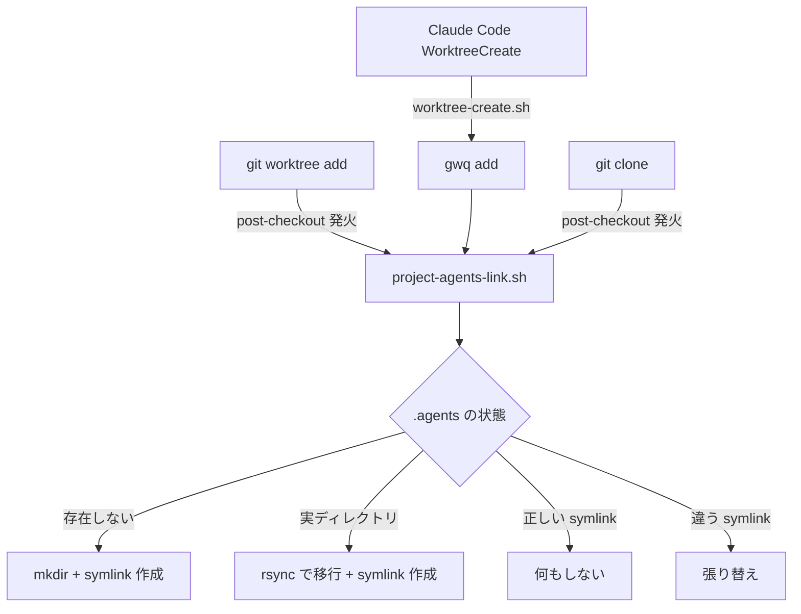

## 課題

Claude Code でマルチエージェント開発をしていると、プロジェクトルートに `.agents/` というディレクトリが育っていく。ここにはワークスペースの記録、計画ファイル、一時ファイルなどが入る。

```
my-project/
├── .agents/
│   ├── workspaces/
│   ├── plans/
│   └── tmp/
├── src/
└── ...
```

これは単一ブランチで作業しているうちは問題ないが、**git worktree** を使い始めると破綻する。

- worktree ごとに `.agents/` が分散し、ワークスペースの記録がバラバラになる
- main ブランチを削除したタイミングで `.agents/` のデータも消える
- worktree を削除すると `.agents/` も一緒に消える

要するに **AI のワークスペースのライフサイクルと、git ブランチのライフサイクルが結合してしまっている** のが問題だ。

## 解決策

`.agents/` の実体をホームディレクトリ配下に置き、プロジェクトルートにはシンボリックリンクだけを残す。

```
~/.project-agents-dir/
└── {org}/
    └── {repo}/          ← 実体（ブランチ・worktree に依存しない）
        ├── workspaces/
        ├── plans/
        └── tmp/

~/ghq/.../my-project/.agents → ~/.project-agents-dir/org/repo  (symlink)
~/ghq/.../my-project=feature/.agents → 同上                     (symlink)
```

`{org}/{repo}` は `git remote get-url origin` から自動抽出するので、同じリポジトリであればどの worktree からでも同じデータにアクセスできる。

## 実装

3 つのシェルスクリプトで構成される。

### 1. 共通ロジック: `project-agents-link.sh`

org/repo の抽出と symlink 作成を行うヘルパー。既存の実ディレクトリがあれば自動で移行する。

```bash:~/.claude/hooks/project-agents-link.sh
#!/bin/bash
PROJECT_AGENTS_BASE="$HOME/.project-agents-dir"

# git remote origin URL から org/repo を抽出
extract_org_repo() {
    local dir="$1"
    local url
    url=$(git -C "$dir" remote get-url origin 2>/dev/null) || return 1
    echo "$url" | sed -E 's#^(https?://[^/]+/|git@[^:]+:)##; s#\.git$##'
}

ensure_project_agents_link() {
    local target_dir="${1:-.}"
    target_dir=$(cd "$target_dir" && pwd)

    local org_repo
    org_repo=$(extract_org_repo "$target_dir") || {
        echo "Warning: No git remote origin found in $target_dir, skipping .agents link" >&2
        return 1
    }

    local agents_store="$PROJECT_AGENTS_BASE/$org_repo"
    local agents_link="$target_dir/.agents"

    mkdir -p "$agents_store"

    if [ -L "$agents_link" ]; then
        local current_target
        current_target=$(readlink "$agents_link")
        if [ "$current_target" = "$agents_store" ]; then
            return 0
        fi
        rm "$agents_link"
    elif [ -d "$agents_link" ]; then
        # 実ディレクトリが存在 → 中身を移行してからリンク
        echo "Migrating existing .agents/ to $agents_store" >&2
        rsync -a --ignore-existing "$agents_link/" "$agents_store/"
        rm -rf "$agents_link"
    fi

    ln -s "$agents_store" "$agents_link"
    echo "Linked $agents_link -> $agents_store" >&2
}
```

ポイント:

- HTTPS (`https://github.com/org/repo.git`) と SSH (`git@github.com:org/repo.git`) の両方に対応
- 既存の `.agents/` が実ディレクトリの場合は `rsync --ignore-existing` でマージ移行
- 既に正しい symlink が張られていれば何もしない（冪等）

### 2. git hook: `post-checkout`

`git worktree add` や `git clone` 時に自動で symlink を作成する。

```bash:~/.config/git/hooks/post-checkout
#!/bin/bash
LINK_SCRIPT="$HOME/.claude/hooks/project-agents-link.sh"
[ -f "$LINK_SCRIPT" ] || exit 0

source "$LINK_SCRIPT"
ensure_project_agents_link "$(pwd)" 2>/dev/null

exit 0
```

`core.hooksPath` でグローバルに適用するので、リポジトリごとの設定は不要。

```bash
git config --global core.hooksPath ~/.config/git/hooks
```

### 3. Claude Code hook: `worktree-create.sh`

Claude Code の `WorktreeCreate` イベントで [gwq](https://github.com/d-kuro/gwq) を使って worktree を作成し、同時に symlink も張る。

```bash:~/.claude/hooks/worktree-create.sh
#!/bin/bash
INPUT=$(cat)
NAME=$(echo "$INPUT" | jq -r '.name // ""')

[ -z "$NAME" ] && { echo "Error: No name provided" >&2; exit 1; }

BRANCH="worktree-${NAME}"

gwq add -b "$BRANCH" >&2 || { echo "Error: gwq add failed" >&2; exit 1; }

WORKTREE_PATH=$(git worktree list --porcelain 2>/dev/null | awk -v branch="refs/heads/$BRANCH" '
    /^worktree / { path=$2 }
    $0 == "branch " branch { print path; exit }
')

[ -z "$WORKTREE_PATH" ] && { echo "Error: Could not find worktree path" >&2; exit 1; }

source "$HOME/.claude/hooks/project-agents-link.sh"
ensure_project_agents_link "$WORKTREE_PATH"

echo "$WORKTREE_PATH"
```

Claude Code の `settings.json` に以下を追加:

```json
{
  "hooks": {
    "WorktreeCreate": [
      {
        "hooks": [
          {
            "type": "command",
            "command": "$HOME/.claude/hooks/worktree-create.sh"
          }
        ]
      }
    ]
  }
}
```

## gitignore

`.agents/` は git 管理対象外にする。`~/.config/git/ignore` に追加しておけばグローバルに効く。

```text:~/.config/git/ignore
.agents/
```

## 動作フロー



## `core.hooksPath` の罠

最初は `.git/hooks/post-checkout` にフックを配置したが、全く発火しなかった。

原因は `core.hooksPath` がグローバルに設定されていたこと。**`core.hooksPath` が設定されている場合、`.git/hooks/` は完全に無視される。** フックは `core.hooksPath` で指定されたディレクトリのものだけが使われる。

```bash
# これが設定されていると .git/hooks/ は死ぬ
git config --global core.hooksPath ~/.config/git/hooks
```

逆に言えば、`core.hooksPath` にフックを置けばリポジトリごとのインストールは不要で、全リポに一括適用できるという利点がある。

## まとめ

- `.agents/` の実体を `~/.project-agents-dir/{org}/{repo}/` に集約
- git の `post-checkout` hook と Claude Code の `WorktreeCreate` hook で自動 symlink
- `core.hooksPath` でグローバルに適用、リポごとの設定不要
- 既存の `.agents/` ディレクトリは自動で移行

これにより、**AI ワークスペースのライフサイクルを git ブランチのライフサイクルから完全に分離** できた。worktree を作っても消しても、main ブランチを削除しても、AI が蓄積した知識は `~/.project-agents-dir/` に安全に残り続ける。
